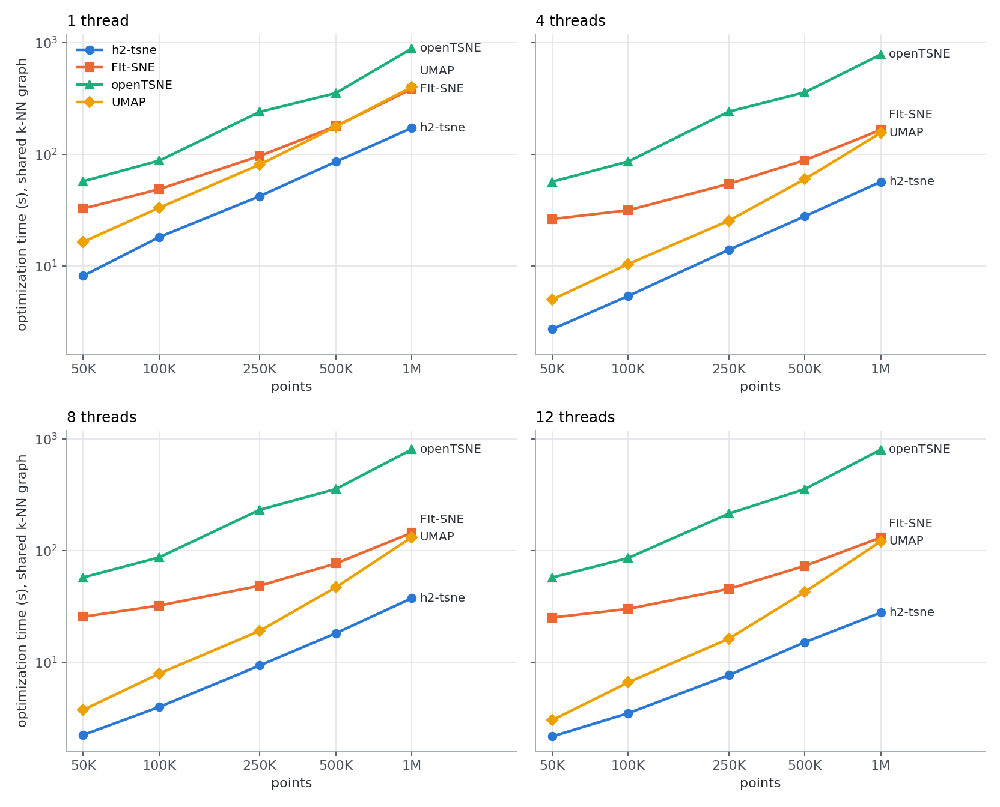
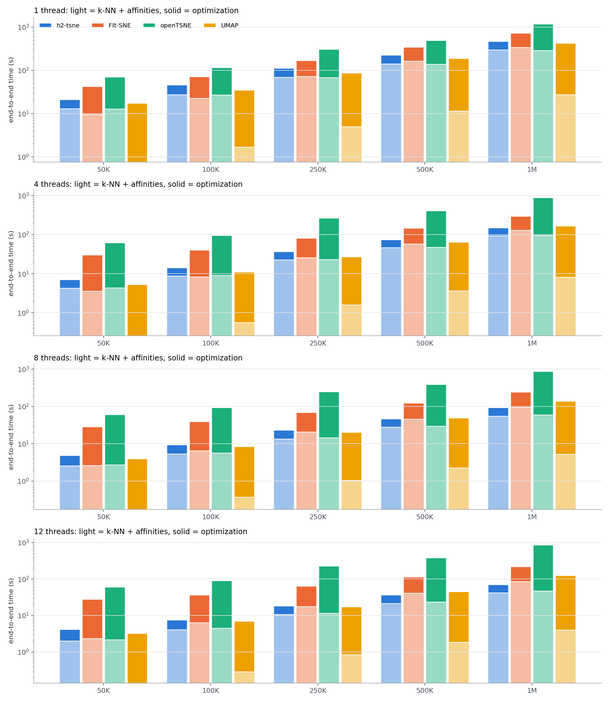

# t-SNE benchmark (2D): tsne-h2pack vs FIt-SNE vs openTSNE vs UMAP

Dataset `zheng`, 2D, perplexity 30, 1000 iterations (250 at exaggeration 12), each library's own 'auto' learning-rate rule (see README: N/12 for tsne-h2pack and FIt-SNE; openTSNE N/12 then N). Times in seconds, mean ± sample std over reps. Machine: `macOS-27.2-arm64-arm-64bit-Mach-O`.

All three t-SNE libraries optimize the **same P**, built from one shared pynndescent k-NN graph (FIt-SNE loads it as precomputed affinities), so the optimization columns differ only in how the gradient is computed. UMAP runs its defaults on a k=15 graph from the same k-NN code.

## 1. Optimization time (shared graph, identical P)

| threads | N | tsne-h2pack | FIt-SNE | openTSNE | UMAP | FIt-SNE / h2pack | openTSNE / h2pack |
|---|---|---|---|---|---|---|---|
| 1 | 50K | 8.2 ± 0.1 | 32.7 ± 2.6 | 57.4 ± 2.3 | 16.5 ± 0.3 | 4.0× | 7.0× |
| 1 | 100K | 18.2 ± 1.2 | 48.7 ± 1.9 | 87.8 ± 5.3 | 33.2 ± 1.0 | 2.7× | 4.8× |
| 1 | 250K | 42.2 ± 0.1 | 96.8 ± 1.4 | 239.1 ± 26.7 | 81.0 ± 1.9 | 2.3× | 5.7× |
| 1 | 500K | 85.8 ± 2.0 | 177.9 ± 4.0 | 352.0 ± 6.7 | 176.3 ± 5.8 | 2.1× | 4.1× |
| 1 | 1M | 171.8 | 384.4 | 882.6 | 398.8 | 2.2× | 5.1× |
| 4 | 50K | 2.7 ± 0.1 | 26.4 ± 3.8 | 56.9 ± 2.6 | 5.0 ± 0.1 | 9.7× | 20.9× |
| 4 | 100K | 5.4 ± 0.1 | 31.6 ± 0.8 | 86.3 ± 3.3 | 10.4 ± 0.2 | 5.8× | 16.0× |
| 4 | 250K | 14.0 ± 0.2 | 54.4 ± 1.0 | 240.3 ± 6.0 | 25.5 ± 0.6 | 3.9× | 17.2× |
| 4 | 500K | 27.9 ± 0.7 | 88.5 ± 2.1 | 357.3 ± 10.0 | 59.9 ± 0.1 | 3.2× | 12.8× |
| 4 | 1M | 56.8 | 165.3 | 780.4 | 155.8 | 2.9× | 13.7× |
| 8 | 50K | 2.2 ± 0.1 | 25.6 ± 3.7 | 57.5 ± 2.8 | 3.8 ± 0.1 | 11.4× | 25.6× |
| 8 | 100K | 4.0 ± 0.4 | 32.2 ± 1.3 | 86.9 ± 4.3 | 7.9 ± 0.1 | 8.1× | 21.8× |
| 8 | 250K | 9.4 ± 0.8 | 48.4 ± 4.0 | 231.8 ± 25.0 | 19.1 ± 0.4 | 5.2× | 24.7× |
| 8 | 500K | 18.2 ± 0.8 | 76.6 ± 3.4 | 355.3 ± 3.0 | 46.9 ± 0.4 | 4.2× | 19.5× |
| 8 | 1M | 37.5 | 144.3 | 802.9 | 131.3 | 3.9× | 21.4× |
| 12 | 50K | 2.2 ± 0.1 | 25.1 ± 3.1 | 57.3 ± 2.8 | 3.0 ± 0.0 | 11.6× | 26.4× |
| 12 | 100K | 3.5 ± 0.2 | 30.1 ± 0.9 | 85.7 ± 3.6 | 6.6 ± 0.1 | 8.6× | 24.4× |
| 12 | 250K | 7.7 ± 0.5 | 45.3 ± 2.4 | 213.9 ± 25.6 | 16.2 ± 0.2 | 5.9× | 27.9× |
| 12 | 500K | 15.1 ± 1.0 | 72.8 ± 3.6 | 354.7 ± 25.6 | 42.6 ± 2.1 | 4.8× | 23.5× |
| 12 | 1M | 27.8 | 130.8 | 800.3 | 120.9 | 4.7× | 28.8× |

## 2. Embedding quality (one common P for every library)

KL against the common P and kNN-preservation@10. The three t-SNE embeddings count as matched when each is within 3% (KL) and 0.015 (kNN-preservation) of the best of the three. UMAP optimizes a different objective; its scores are shown for reference.

| threads | N | tsne-h2pack (KL / kNN-pres) | FIt-SNE (KL / kNN-pres) | openTSNE (KL / kNN-pres) | UMAP (KL / kNN-pres) | t-SNE matched? |
|---|---|---|---|---|---|---|
| 1 | 50K | 2.775 / 0.301 | 2.754 / 0.302 | 2.711 / 0.307 | 4.660 / 0.106 | yes |
| 1 | 100K | 3.267 / 0.259 | 3.252 / 0.262 | 3.201 / 0.269 | 5.265 / 0.076 | yes |
| 1 | 250K | 3.948 / 0.200 | 3.921 / 0.204 | 3.863 / 0.214 | 6.078 / 0.048 | yes |
| 1 | 500K | 4.496 / 0.154 | 4.472 / 0.157 | 4.417 / 0.169 | 6.698 / 0.034 | yes |
| 1 | 1M | 5.024 / 0.114 | 5.017 / 0.118 | 4.957 / 0.127 | 7.306 / 0.025 | yes |
| 4 | 50K | 2.776 / 0.301 | 2.754 / 0.302 | 2.711 / 0.307 | 4.657 / 0.107 | yes |
| 4 | 100K | 3.265 / 0.260 | 3.253 / 0.262 | 3.202 / 0.269 | 5.269 / 0.076 | yes |
| 4 | 250K | 3.948 / 0.201 | 3.921 / 0.203 | 3.862 / 0.214 | 6.083 / 0.047 | yes |
| 4 | 500K | 4.497 / 0.157 | 4.469 / 0.156 | 4.417 / 0.169 | 6.700 / 0.035 | yes |
| 4 | 1M | 5.046 / 0.116 | 5.012 / 0.117 | 4.968 / 0.125 | 7.306 / 0.024 | yes |
| 8 | 50K | 2.770 / 0.301 | 2.756 / 0.301 | 2.711 / 0.308 | 4.654 / 0.109 | yes |
| 8 | 100K | 3.262 / 0.259 | 3.257 / 0.260 | 3.201 / 0.269 | 5.268 / 0.076 | yes |
| 8 | 250K | 3.946 / 0.201 | 3.921 / 0.203 | 3.863 / 0.215 | 6.085 / 0.049 | yes |
| 8 | 500K | 4.499 / 0.155 | 4.471 / 0.157 | 4.416 / 0.168 | 6.703 / 0.035 | yes |
| 8 | 1M | 5.040 / 0.115 | 5.018 / 0.117 | 4.953 / 0.128 | 7.318 / 0.024 | yes |
| 12 | 50K | 2.765 / 0.301 | 2.755 / 0.303 | 2.710 / 0.308 | 4.659 / 0.106 | yes |
| 12 | 100K | 3.264 / 0.259 | 3.251 / 0.261 | 3.201 / 0.269 | 5.261 / 0.076 | yes |
| 12 | 250K | 3.949 / 0.201 | 3.922 / 0.204 | 3.862 / 0.214 | 6.082 / 0.047 | yes |
| 12 | 500K | 4.500 / 0.155 | 4.475 / 0.156 | 4.421 / 0.168 | 6.700 / 0.034 | yes |
| 12 | 1M | 5.026 / 0.116 | 5.016 / 0.117 | 4.968 / 0.127 | 7.312 / 0.025 | yes |

## 3. Time breakdown, end to end

`k-NN` is the shared pynndescent build (k=90 for t-SNE, k=15 for UMAP), `setup` is everything between the graph and the first iteration (perplexity calibration, symmetrization, initialization). FIt-SNE's wrapper accepts finished affinities but not a k-NN graph, so its front end is measured separately as its own bundled Annoy search plus calibration (one rep per size). numba's JIT compilation is excluded from the pynndescent and UMAP times: it is a per-process constant (measured here: 4.2 s for pynndescent), paid on a toy input before the timer starts.

| threads | N | library | k-NN | setup | optimize | total | front-end share | peak RSS (GB) |
|---|---|---|---|---|---|---|---|---|
| 1 | 50K | tsne-h2pack | 12.1 | 0.8 | 8.2 | 21.1 | 61% | 1.3 |
| 1 | 50K | FIt-SNE | 9.5 (own Annoy + P) | – | 32.7 | 42.2 | 22% | 0.7 |
| 1 | 50K | openTSNE | 12.1 | 0.5 | 57.4 | 70.0 | 18% | 1.3 |
| 1 | 50K | UMAP | 0.8 | – | 16.5 | 17.2 | 4% | 1.1 |
| 1 | 100K | tsne-h2pack | 26.0 | 1.6 | 18.2 | 45.7 | 60% | 2.0 |
| 1 | 100K | FIt-SNE | 22.4 (own Annoy + P) | – | 48.7 | 71.2 | 32% | 1.3 |
| 1 | 100K | openTSNE | 26.0 | 1.1 | 87.8 | 114.8 | 24% | 1.8 |
| 1 | 100K | UMAP | 1.7 | – | 33.2 | 34.9 | 5% | 1.8 |
| 1 | 250K | tsne-h2pack | 65.2 | 3.6 | 42.2 | 111.1 | 62% | 4.4 |
| 1 | 250K | FIt-SNE | 72.3 (own Annoy + P) | – | 96.8 | 169.1 | 43% | 2.9 |
| 1 | 250K | openTSNE | 65.2 | 2.9 | 239.1 | 307.2 | 22% | 3.2 |
| 1 | 250K | UMAP | 5.0 | – | 81.0 | 86.0 | 6% | 3.9 |
| 1 | 500K | tsne-h2pack | 131.8 | 8.0 | 85.8 | 225.7 | 62% | 6.8 |
| 1 | 500K | FIt-SNE | 163.6 (own Annoy + P) | – | 177.9 | 341.5 | 48% | 5.0 |
| 1 | 500K | openTSNE | 131.8 | 5.6 | 352.0 | 489.3 | 28% | 5.2 |
| 1 | 500K | UMAP | 11.4 | – | 176.3 | 187.7 | 6% | 6.7 |
| 1 | 1M | tsne-h2pack | 275.8 | 18.8 | 171.8 | 466.4 | 63% | 14.3 |
| 1 | 1M | FIt-SNE | 335.5 (own Annoy + P) | – | 384.4 | 719.8 | 47% | 5.5 |
| 1 | 1M | openTSNE | 275.8 | 11.6 | 882.6 | 1170.1 | 25% | 7.0 |
| 1 | 1M | UMAP | 27.1 | – | 398.8 | 425.9 | 6% | 12.0 |
| 4 | 50K | tsne-h2pack | 3.8 | 0.4 | 2.7 | 6.9 | 61% | 1.4 |
| 4 | 50K | FIt-SNE | 3.6 (own Annoy + P) | – | 26.4 | 29.9 | 12% | 0.7 |
| 4 | 50K | openTSNE | 3.8 | 0.5 | 56.9 | 61.2 | 7% | 1.5 |
| 4 | 50K | UMAP | 0.3 | – | 5.0 | 5.3 | 5% | 1.1 |
| 4 | 100K | tsne-h2pack | 7.9 | 0.8 | 5.4 | 14.1 | 62% | 2.2 |
| 4 | 100K | FIt-SNE | 8.2 (own Annoy + P) | – | 31.6 | 39.8 | 21% | 1.3 |
| 4 | 100K | openTSNE | 7.9 | 1.1 | 86.3 | 95.3 | 9% | 1.8 |
| 4 | 100K | UMAP | 0.6 | – | 10.4 | 11.0 | 5% | 1.8 |
| 4 | 250K | tsne-h2pack | 20.3 | 2.0 | 14.0 | 36.3 | 62% | 4.4 |
| 4 | 250K | FIt-SNE | 25.4 (own Annoy + P) | – | 54.4 | 79.8 | 32% | 2.9 |
| 4 | 250K | openTSNE | 20.3 | 2.7 | 240.3 | 263.3 | 9% | 3.6 |
| 4 | 250K | UMAP | 1.6 | – | 25.5 | 27.0 | 6% | 4.4 |
| 4 | 500K | tsne-h2pack | 41.6 | 4.3 | 27.9 | 73.8 | 62% | 7.9 |
| 4 | 500K | FIt-SNE | 57.2 (own Annoy + P) | – | 88.5 | 145.7 | 39% | 5.6 |
| 4 | 500K | openTSNE | 41.6 | 5.5 | 357.3 | 404.5 | 12% | 6.2 |
| 4 | 500K | UMAP | 3.6 | – | 59.9 | 63.5 | 6% | 9.5 |
| 4 | 1M | tsne-h2pack | 83.0 | 9.5 | 56.8 | 149.4 | 62% | 11.1 |
| 4 | 1M | FIt-SNE | 127.7 (own Annoy + P) | – | 165.3 | 293.0 | 44% | 10.1 |
| 4 | 1M | openTSNE | 83.0 | 11.3 | 780.4 | 874.7 | 11% | 10.7 |
| 4 | 1M | UMAP | 8.1 | – | 155.8 | 163.9 | 5% | 11.8 |
| 8 | 50K | tsne-h2pack | 2.2 | 0.4 | 2.2 | 4.8 | 53% | 1.3 |
| 8 | 50K | FIt-SNE | 2.6 (own Annoy + P) | – | 25.6 | 28.2 | 9% | 0.7 |
| 8 | 50K | openTSNE | 2.2 | 0.5 | 57.5 | 60.2 | 4% | 1.4 |
| 8 | 50K | UMAP | 0.2 | – | 3.8 | 3.9 | 4% | 1.1 |
| 8 | 100K | tsne-h2pack | 4.6 | 0.7 | 4.0 | 9.3 | 57% | 2.1 |
| 8 | 100K | FIt-SNE | 6.4 (own Annoy + P) | – | 32.2 | 38.6 | 17% | 1.3 |
| 8 | 100K | openTSNE | 4.6 | 1.1 | 86.9 | 92.5 | 6% | 1.9 |
| 8 | 100K | UMAP | 0.4 | – | 7.9 | 8.3 | 4% | 1.8 |
| 8 | 250K | tsne-h2pack | 11.6 | 1.8 | 9.4 | 22.8 | 59% | 4.1 |
| 8 | 250K | FIt-SNE | 20.4 (own Annoy + P) | – | 48.4 | 68.8 | 30% | 2.7 |
| 8 | 250K | openTSNE | 11.6 | 2.7 | 231.8 | 246.1 | 6% | 3.2 |
| 8 | 250K | UMAP | 1.0 | – | 19.1 | 20.1 | 5% | 3.9 |
| 8 | 500K | tsne-h2pack | 24.0 | 3.6 | 18.2 | 45.7 | 60% | 9.1 |
| 8 | 500K | FIt-SNE | 45.2 (own Annoy + P) | – | 76.6 | 121.8 | 37% | 6.2 |
| 8 | 500K | openTSNE | 24.0 | 5.5 | 355.3 | 384.8 | 8% | 6.7 |
| 8 | 500K | UMAP | 2.3 | – | 46.9 | 49.1 | 5% | 10.3 |
| 8 | 1M | tsne-h2pack | 47.1 | 7.5 | 37.5 | 92.1 | 59% | 15.6 |
| 8 | 1M | FIt-SNE | 94.6 (own Annoy + P) | – | 144.3 | 238.9 | 40% | 10.1 |
| 8 | 1M | openTSNE | 47.1 | 11.2 | 802.9 | 861.3 | 7% | 10.9 |
| 8 | 1M | UMAP | 5.2 | – | 131.3 | 136.5 | 4% | 12.0 |
| 12 | 50K | tsne-h2pack | 1.6 | 0.4 | 2.2 | 4.1 | 48% | 1.4 |
| 12 | 50K | FIt-SNE | 2.3 (own Annoy + P) | – | 25.1 | 27.4 | 8% | 0.7 |
| 12 | 50K | openTSNE | 1.6 | 0.5 | 57.3 | 59.5 | 4% | 1.3 |
| 12 | 50K | UMAP | 0.1 | – | 3.0 | 3.2 | 4% | 1.1 |
| 12 | 100K | tsne-h2pack | 3.4 | 0.7 | 3.5 | 7.5 | 53% | 2.2 |
| 12 | 100K | FIt-SNE | 6.3 (own Annoy + P) | – | 30.1 | 36.4 | 17% | 1.3 |
| 12 | 100K | openTSNE | 3.4 | 1.1 | 85.7 | 90.1 | 5% | 2.0 |
| 12 | 100K | UMAP | 0.3 | – | 6.6 | 6.9 | 4% | 1.8 |
| 12 | 250K | tsne-h2pack | 8.8 | 1.7 | 7.7 | 18.1 | 58% | 4.2 |
| 12 | 250K | FIt-SNE | 17.3 (own Annoy + P) | – | 45.3 | 62.7 | 28% | 2.6 |
| 12 | 250K | openTSNE | 8.8 | 2.7 | 213.9 | 225.4 | 5% | 3.3 |
| 12 | 250K | UMAP | 0.8 | – | 16.2 | 17.1 | 5% | 4.4 |
| 12 | 500K | tsne-h2pack | 17.8 | 3.4 | 15.1 | 36.3 | 58% | 9.1 |
| 12 | 500K | FIt-SNE | 40.6 (own Annoy + P) | – | 72.8 | 113.4 | 36% | 5.4 |
| 12 | 500K | openTSNE | 17.8 | 5.6 | 354.7 | 378.2 | 6% | 5.7 |
| 12 | 500K | UMAP | 1.8 | – | 42.6 | 44.4 | 4% | 7.4 |
| 12 | 1M | tsne-h2pack | 34.8 | 6.8 | 27.8 | 69.3 | 60% | 15.7 |
| 12 | 1M | FIt-SNE | 83.9 (own Annoy + P) | – | 130.8 | 214.7 | 39% | 10.1 |
| 12 | 1M | openTSNE | 34.8 | 11.4 | 800.3 | 846.5 | 5% | 10.8 |
| 12 | 1M | UMAP | 4.0 | – | 120.9 | 124.9 | 3% | 12.5 |

## 4. Thread scaling from 1 thread

1 → 4 threads:

| N | tsne-h2pack optimize | FIt-SNE optimize | openTSNE optimize | UMAP optimize | pynndescent k-NN (k=90) |
|---|---|---|---|---|---|
| 50K | 3.0× | 1.2× | 1.0× | 3.3× | 3.2× |
| 100K | 3.4× | 1.5× | 1.0× | 3.2× | 3.3× |
| 250K | 3.0× | 1.8× | 1.0× | 3.2× | 3.2× |
| 500K | 3.1× | 2.0× | 1.0× | 2.9× | 3.2× |
| 1M | 3.0× | 2.3× | 1.1× | 2.6× | 3.3× |

1 → 8 threads:

| N | tsne-h2pack optimize | FIt-SNE optimize | openTSNE optimize | UMAP optimize | pynndescent k-NN (k=90) |
|---|---|---|---|---|---|
| 50K | 3.6× | 1.3× | 1.0× | 4.4× | 5.6× |
| 100K | 4.5× | 1.5× | 1.0× | 4.2× | 5.7× |
| 250K | 4.5× | 2.0× | 1.0× | 4.2× | 5.6× |
| 500K | 4.7× | 2.3× | 1.0× | 3.8× | 5.5× |
| 1M | 4.6× | 2.7× | 1.1× | 3.0× | 5.9× |

1 → 12 threads:

| N | tsne-h2pack optimize | FIt-SNE optimize | openTSNE optimize | UMAP optimize | pynndescent k-NN (k=90) |
|---|---|---|---|---|---|
| 50K | 3.8× | 1.3× | 1.0× | 5.4× | 7.5× |
| 100K | 5.2× | 1.6× | 1.0× | 5.0× | 7.7× |
| 250K | 5.5× | 2.1× | 1.1× | 5.0× | 7.4× |
| 500K | 5.7× | 2.4× | 1.0× | 4.1× | 7.4× |
| 1M | 6.2× | 2.9× | 1.1× | 3.3× | 7.9× |

## 5. Inside tsne-h2pack's optimization

| threads | N | optimize | attractive forces | H² rebuild | H² matvec | other |
|---|---|---|---|---|---|---|
| 1 | 50K | 8.2 | 2.1 (26%) | 3.4 (42%) | 2.6 (31%) | 0.1 |
| 1 | 100K | 18.2 | 4.6 (25%) | 6.7 (37%) | 6.6 (37%) | 0.2 |
| 1 | 250K | 42.2 | 12.0 (28%) | 15.0 (36%) | 13.2 (31%) | 2.0 |
| 1 | 500K | 85.8 | 26.8 (31%) | 28.9 (34%) | 29.2 (34%) | 1.0 |
| 1 | 1M | 171.8 | 60.7 (35%) | 53.5 (31%) | 55.6 (32%) | 2.1 |
| 4 | 50K | 2.7 | 0.6 (22%) | 1.2 (43%) | 0.8 (30%) | 0.1 |
| 4 | 100K | 5.4 | 1.3 (23%) | 2.2 (41%) | 1.7 (32%) | 0.2 |
| 4 | 250K | 14.0 | 3.6 (26%) | 5.3 (38%) | 4.3 (31%) | 0.7 |
| 4 | 500K | 27.9 | 8.1 (29%) | 10.4 (37%) | 8.9 (32%) | 0.5 |
| 4 | 1M | 56.8 | 18.6 (33%) | 19.5 (34%) | 17.7 (31%) | 1.0 |
| 8 | 50K | 2.2 | 0.5 (20%) | 0.9 (40%) | 0.7 (30%) | 0.2 |
| 8 | 100K | 4.0 | 0.9 (22%) | 1.7 (41%) | 1.2 (30%) | 0.3 |
| 8 | 250K | 9.4 | 2.2 (24%) | 3.7 (40%) | 2.8 (30%) | 0.6 |
| 8 | 500K | 18.2 | 4.8 (26%) | 7.3 (40%) | 5.5 (30%) | 0.6 |
| 8 | 1M | 37.5 | 11.1 (30%) | 14.0 (37%) | 11.4 (30%) | 0.9 |
| 12 | 50K | 2.2 | 0.4 (20%) | 0.8 (37%) | 0.7 (31%) | 0.3 |
| 12 | 100K | 3.5 | 0.7 (21%) | 1.4 (39%) | 1.1 (30%) | 0.3 |
| 12 | 250K | 7.7 | 1.7 (22%) | 3.0 (39%) | 2.3 (30%) | 0.6 |
| 12 | 500K | 15.1 | 3.7 (25%) | 6.1 (40%) | 4.6 (31%) | 0.6 |
| 12 | 1M | 27.8 | 7.8 (28%) | 10.7 (38%) | 8.5 (30%) | 0.9 |
