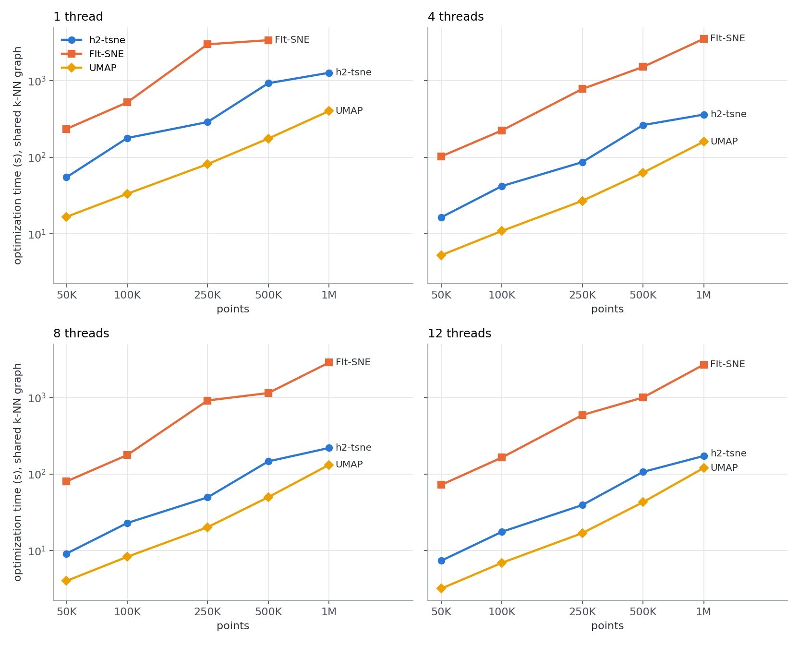
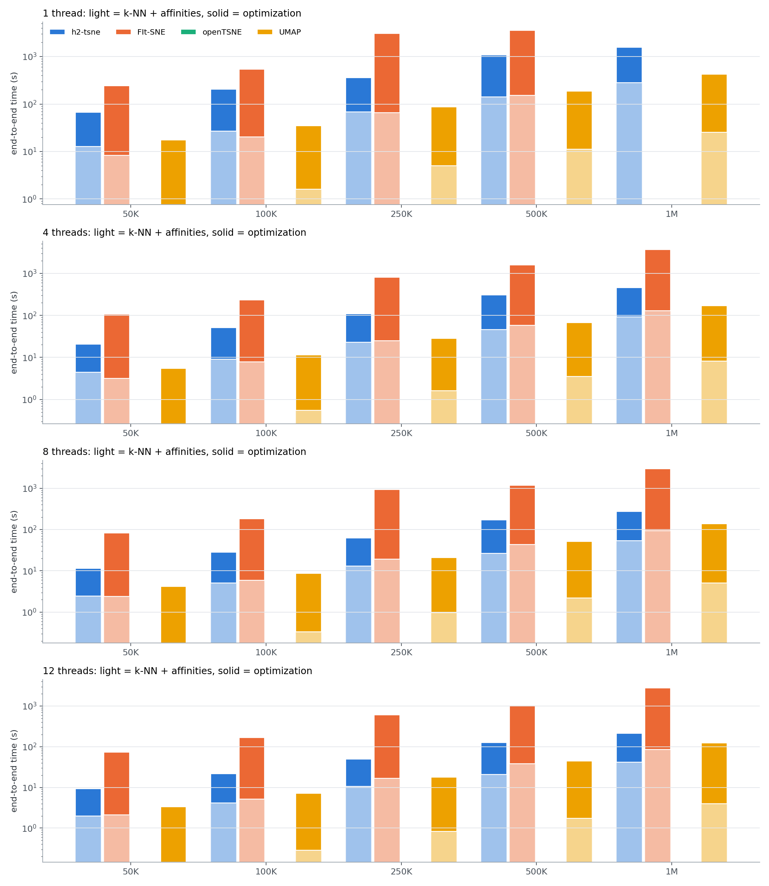

# t-SNE benchmark (3D): tsne-h2pack vs FIt-SNE vs openTSNE vs UMAP

Dataset `zheng`, 3D, perplexity 30, 1000 iterations (250 at exaggeration 12), each library's own 'auto' learning-rate rule (see README: N/12 for tsne-h2pack and FIt-SNE; openTSNE N/12 then N). Times in seconds, mean ± sample std over reps. Machine: `macOS-27.2-arm64-arm-64bit-Mach-O`. **3D embeddings**: FIt-SNE and openTSNE have no FFT gradient beyond 2D and run their Barnes-Hut gradient here; tsne-h2pack and UMAP run unchanged with n_components=3.

All three t-SNE libraries optimize the **same P**, built from one shared pynndescent k-NN graph (FIt-SNE loads it as precomputed affinities), so the optimization columns differ only in how the gradient is computed. UMAP runs its defaults on a k=15 graph from the same k-NN code.

## 1. Optimization time (shared graph, identical P)

| threads | N | tsne-h2pack | FIt-SNE | openTSNE | UMAP | FIt-SNE / h2pack | openTSNE / h2pack |
|---|---|---|---|---|---|---|---|
| 1 | 50K | 54.8 | 235.1 | – | 16.7 | 4.3× | – |
| 1 | 100K | 178.6 | 521.8 | – | 33.3 | 2.9× | – |
| 1 | 250K | 288.8 | 2999.3 | – | 81.4 | 10.4× | – |
| 1 | 500K | 930.0 | 3395.3 | – | 175.7 | 3.7× | – |
| 1 | 1M | 1273.1 | – | – | 402.6 | – | – |
| 4 | 50K | 16.4 | 102.6 | – | 5.3 | 6.3× | – |
| 4 | 100K | 42.1 | 224.6 | – | 10.9 | 5.3× | – |
| 4 | 250K | 86.4 | 781.5 | – | 27.0 | 9.0× | – |
| 4 | 500K | 263.7 | 1517.9 | – | 63.0 | 5.8× | – |
| 4 | 1M | 361.7 | 3541.2 | – | 160.2 | 9.8× | – |
| 8 | 50K | 9.1 | 80.1 | – | 4.0 | 8.8× | – |
| 8 | 100K | 22.9 | 177.3 | – | 8.3 | 7.7× | – |
| 8 | 250K | 49.5 | 914.7 | – | 20.2 | 18.5× | – |
| 8 | 500K | 146.4 | 1145.7 | – | 49.8 | 7.8× | – |
| 8 | 1M | 219.3 | 2866.0 | – | 131.9 | 13.1× | – |
| 12 | 50K | 7.4 | 72.1 | – | 3.2 | 9.8× | – |
| 12 | 100K | 17.6 | 164.5 | – | 6.9 | 9.4× | – |
| 12 | 250K | 39.3 | 590.2 | – | 16.9 | 15.0× | – |
| 12 | 500K | 106.6 | 1001.0 | – | 42.9 | 9.4× | – |
| 12 | 1M | 172.4 | 2689.1 | – | 120.0 | 15.6× | – |

## 2. Embedding quality (one common P for every library)

KL against the common P and kNN-preservation@10. The three t-SNE embeddings count as matched when each is within 3% (KL) and 0.015 (kNN-preservation) of the best of the three. UMAP optimizes a different objective; its scores are shown for reference.

| threads | N | tsne-h2pack (KL / kNN-pres) | FIt-SNE (KL / kNN-pres) | openTSNE (KL / kNN-pres) | UMAP (KL / kNN-pres) | t-SNE matched? |
|---|---|---|---|---|---|---|
| 1 | 50K | 2.531 / 0.339 | 2.643 / 0.332 | – | 4.679 / 0.170 | NO: FIt-SNE |
| 1 | 100K | 2.977 / 0.303 | 3.127 / 0.294 | – | 5.306 / 0.129 | NO: FIt-SNE |
| 1 | 250K | 3.609 / 0.271 | 3.708 / 0.263 | – | 6.079 / 0.095 | yes |
| 1 | 500K | 4.139 / 0.247 | 4.230 / 0.233 | – | 6.726 / 0.070 | yes |
| 1 | 1M | 4.673 / 0.223 | – | – | 7.339 / 0.055 | – |
| 4 | 50K | 2.528 / 0.339 | 2.648 / 0.332 | – | 4.680 / 0.168 | NO: FIt-SNE |
| 4 | 100K | 2.975 / 0.303 | 3.103 / 0.296 | – | 5.298 / 0.128 | NO: FIt-SNE |
| 4 | 250K | 3.603 / 0.272 | 3.699 / 0.264 | – | 6.081 / 0.095 | yes |
| 4 | 500K | 4.139 / 0.246 | 4.229 / 0.234 | – | 6.724 / 0.070 | yes |
| 4 | 1M | 4.676 / 0.223 | 4.766 / 0.206 | – | 7.334 / 0.057 | NO: FIt-SNE |
| 8 | 50K | 2.531 / 0.337 | 2.649 / 0.332 | – | 4.676 / 0.171 | NO: FIt-SNE |
| 8 | 100K | 2.979 / 0.303 | 3.110 / 0.295 | – | 5.299 / 0.127 | NO: FIt-SNE |
| 8 | 250K | 3.611 / 0.272 | 3.703 / 0.264 | – | 6.078 / 0.096 | yes |
| 8 | 500K | 4.137 / 0.247 | 4.228 / 0.234 | – | 6.726 / 0.069 | yes |
| 8 | 1M | 4.671 / 0.223 | 4.766 / 0.206 | – | 7.337 / 0.056 | NO: FIt-SNE |
| 12 | 50K | 2.529 / 0.337 | 2.664 / 0.331 | – | 4.674 / 0.168 | NO: FIt-SNE |
| 12 | 100K | 2.976 / 0.303 | 3.113 / 0.294 | – | 5.303 / 0.128 | NO: FIt-SNE |
| 12 | 250K | 3.608 / 0.272 | 3.696 / 0.264 | – | 6.077 / 0.096 | yes |
| 12 | 500K | 4.141 / 0.246 | 4.222 / 0.233 | – | 6.728 / 0.071 | yes |
| 12 | 1M | 4.682 / 0.223 | 4.752 / 0.208 | – | 7.338 / 0.055 | NO: FIt-SNE |

## 3. Time breakdown, end to end

`k-NN` is the shared pynndescent build (k=90 for t-SNE, k=15 for UMAP), `setup` is everything between the graph and the first iteration (perplexity calibration, symmetrization, initialization). FIt-SNE's wrapper accepts finished affinities but not a k-NN graph, so its front end is measured separately as its own bundled Annoy search plus calibration (one rep per size). numba's JIT compilation is excluded from the pynndescent and UMAP times: it is a per-process constant (measured here: 4.1 s for pynndescent), paid on a toy input before the timer starts.

| threads | N | library | k-NN | setup | optimize | total | front-end share | peak RSS (GB) |
|---|---|---|---|---|---|---|---|---|
| 1 | 50K | tsne-h2pack | 12.2 | 0.6 | 54.8 | 67.6 | 19% | 1.1 |
| 1 | 50K | FIt-SNE | 8.2 (own Annoy + P) | – | 235.1 | 243.4 | 3% | 0.8 |
| 1 | 50K | UMAP | 0.8 | – | 16.7 | 17.4 | 4% | 1.2 |
| 1 | 100K | tsne-h2pack | 25.3 | 1.4 | 178.6 | 205.2 | 13% | 2.1 |
| 1 | 100K | FIt-SNE | 20.2 (own Annoy + P) | – | 521.8 | 542.0 | 4% | 1.5 |
| 1 | 100K | UMAP | 1.6 | – | 33.3 | 34.9 | 5% | 2.3 |
| 1 | 250K | tsne-h2pack | 65.0 | 3.5 | 288.8 | 357.4 | 19% | 4.9 |
| 1 | 250K | FIt-SNE | 65.8 (own Annoy + P) | – | 2999.3 | 3065.1 | 2% | 3.7 |
| 1 | 250K | UMAP | 5.0 | – | 81.4 | 86.4 | 6% | 4.6 |
| 1 | 500K | tsne-h2pack | 133.2 | 7.6 | 930.0 | 1070.8 | 13% | 9.6 |
| 1 | 500K | FIt-SNE | 151.2 (own Annoy + P) | – | 3395.3 | 3546.5 | 4% | 7.3 |
| 1 | 500K | UMAP | 11.2 | – | 175.7 | 187.0 | 6% | 9.7 |
| 1 | 1M | tsne-h2pack | 263.3 | 16.0 | 1273.1 | 1552.5 | 18% | 15.3 |
| 1 | 1M | UMAP | 25.6 | – | 402.6 | 428.2 | 6% | 16.2 |
| 4 | 50K | tsne-h2pack | 4.0 | 0.4 | 16.4 | 20.8 | 21% | 1.2 |
| 4 | 50K | FIt-SNE | 3.2 (own Annoy + P) | – | 102.6 | 105.8 | 3% | 0.8 |
| 4 | 50K | UMAP | 0.3 | – | 5.3 | 5.5 | 5% | 1.2 |
| 4 | 100K | tsne-h2pack | 8.3 | 0.8 | 42.1 | 51.1 | 18% | 2.3 |
| 4 | 100K | FIt-SNE | 7.8 (own Annoy + P) | – | 224.6 | 232.5 | 3% | 1.5 |
| 4 | 100K | UMAP | 0.6 | – | 10.9 | 11.5 | 5% | 2.3 |
| 4 | 250K | tsne-h2pack | 21.1 | 2.0 | 86.4 | 109.5 | 21% | 5.1 |
| 4 | 250K | FIt-SNE | 25.2 (own Annoy + P) | – | 781.5 | 806.7 | 3% | 3.7 |
| 4 | 250K | UMAP | 1.6 | – | 27.0 | 28.6 | 6% | 4.6 |
| 4 | 500K | tsne-h2pack | 41.5 | 4.2 | 263.7 | 309.4 | 15% | 9.6 |
| 4 | 500K | FIt-SNE | 57.4 (own Annoy + P) | – | 1517.9 | 1575.3 | 4% | 7.3 |
| 4 | 500K | UMAP | 3.5 | – | 63.0 | 66.5 | 5% | 9.7 |
| 4 | 1M | tsne-h2pack | 83.9 | 9.0 | 361.7 | 454.6 | 20% | 12.8 |
| 4 | 1M | FIt-SNE | 127.9 (own Annoy + P) | – | 3541.2 | 3669.0 | 3% | 14.3 |
| 4 | 1M | UMAP | 8.2 | – | 160.2 | 168.4 | 5% | 14.1 |
| 8 | 50K | tsne-h2pack | 2.1 | 0.4 | 9.1 | 11.6 | 21% | 1.2 |
| 8 | 50K | FIt-SNE | 2.4 (own Annoy + P) | – | 80.1 | 82.5 | 3% | 0.8 |
| 8 | 50K | UMAP | 0.2 | – | 4.0 | 4.2 | 4% | 1.2 |
| 8 | 100K | tsne-h2pack | 4.4 | 0.7 | 22.9 | 28.0 | 18% | 2.3 |
| 8 | 100K | FIt-SNE | 5.9 (own Annoy + P) | – | 177.3 | 183.2 | 3% | 1.5 |
| 8 | 100K | UMAP | 0.3 | – | 8.3 | 8.6 | 4% | 2.3 |
| 8 | 250K | tsne-h2pack | 11.2 | 1.7 | 49.5 | 62.5 | 21% | 5.1 |
| 8 | 250K | FIt-SNE | 19.1 (own Annoy + P) | – | 914.7 | 933.8 | 2% | 3.7 |
| 8 | 250K | UMAP | 1.0 | – | 20.2 | 21.1 | 5% | 4.6 |
| 8 | 500K | tsne-h2pack | 23.1 | 3.5 | 146.4 | 173.0 | 15% | 10.0 |
| 8 | 500K | FIt-SNE | 43.2 (own Annoy + P) | – | 1145.7 | 1188.9 | 4% | 7.3 |
| 8 | 500K | UMAP | 2.2 | – | 49.8 | 52.0 | 4% | 9.7 |
| 8 | 1M | tsne-h2pack | 46.5 | 7.5 | 219.3 | 273.3 | 20% | 16.4 |
| 8 | 1M | FIt-SNE | 94.9 (own Annoy + P) | – | 2866.0 | 2960.8 | 3% | 14.3 |
| 8 | 1M | UMAP | 5.1 | – | 131.9 | 136.9 | 4% | 15.0 |
| 12 | 50K | tsne-h2pack | 1.6 | 0.4 | 7.4 | 9.3 | 21% | 1.2 |
| 12 | 50K | FIt-SNE | 2.1 (own Annoy + P) | – | 72.1 | 74.2 | 3% | 0.8 |
| 12 | 50K | UMAP | 0.1 | – | 3.2 | 3.3 | 4% | 1.2 |
| 12 | 100K | tsne-h2pack | 3.4 | 0.7 | 17.6 | 21.7 | 19% | 2.3 |
| 12 | 100K | FIt-SNE | 5.1 (own Annoy + P) | – | 164.5 | 169.7 | 3% | 1.5 |
| 12 | 100K | UMAP | 0.3 | – | 6.9 | 7.2 | 4% | 2.3 |
| 12 | 250K | tsne-h2pack | 8.8 | 1.7 | 39.3 | 49.8 | 21% | 5.1 |
| 12 | 250K | FIt-SNE | 16.8 (own Annoy + P) | – | 590.2 | 607.0 | 3% | 3.7 |
| 12 | 250K | UMAP | 0.8 | – | 16.9 | 17.7 | 5% | 4.6 |
| 12 | 500K | tsne-h2pack | 17.5 | 3.3 | 106.6 | 127.4 | 16% | 9.5 |
| 12 | 500K | FIt-SNE | 38.3 (own Annoy + P) | – | 1001.0 | 1039.3 | 4% | 7.3 |
| 12 | 500K | UMAP | 1.8 | – | 42.9 | 44.6 | 4% | 9.7 |
| 12 | 1M | tsne-h2pack | 35.0 | 7.0 | 172.4 | 214.5 | 20% | 16.3 |
| 12 | 1M | FIt-SNE | 84.7 (own Annoy + P) | – | 2689.1 | 2773.8 | 3% | 14.0 |
| 12 | 1M | UMAP | 4.0 | – | 120.0 | 124.0 | 3% | 14.2 |

## 4. Thread scaling from 1 thread

1 → 4 threads:

| N | tsne-h2pack optimize | FIt-SNE optimize | openTSNE optimize | UMAP optimize | pynndescent k-NN (k=90) |
|---|---|---|---|---|---|
| 50K | 3.3× | 2.3× | – | 3.2× | 3.0× |
| 100K | 4.2× | 2.3× | – | 3.1× | 3.0× |
| 250K | 3.3× | 3.8× | – | 3.0× | 3.1× |
| 500K | 3.5× | 2.2× | – | 2.8× | 3.2× |
| 1M | 3.5× | – | – | 2.5× | 3.1× |

1 → 8 threads:

| N | tsne-h2pack optimize | FIt-SNE optimize | openTSNE optimize | UMAP optimize | pynndescent k-NN (k=90) |
|---|---|---|---|---|---|
| 50K | 6.0× | 2.9× | – | 4.2× | 5.9× |
| 100K | 7.8× | 2.9× | – | 4.0× | 5.8× |
| 250K | 5.8× | 3.3× | – | 4.0× | 5.8× |
| 500K | 6.4× | 3.0× | – | 3.5× | 5.8× |
| 1M | 5.8× | – | – | 3.1× | 5.7× |

1 → 12 threads:

| N | tsne-h2pack optimize | FIt-SNE optimize | openTSNE optimize | UMAP optimize | pynndescent k-NN (k=90) |
|---|---|---|---|---|---|
| 50K | 7.4× | 3.3× | – | 5.2× | 7.6× |
| 100K | 10.2× | 3.2× | – | 4.8× | 7.4× |
| 250K | 7.4× | 5.1× | – | 4.8× | 7.4× |
| 500K | 8.7× | 3.4× | – | 4.1× | 7.6× |
| 1M | 7.4× | – | – | 3.4× | 7.5× |

## 5. Inside tsne-h2pack's optimization

| threads | N | optimize | attractive forces | H² rebuild | H² matvec | other |
|---|---|---|---|---|---|---|
| 1 | 50K | 54.8 | 20.2 (37%) | 22.4 (41%) | 12.0 (22%) | 0.1 |
| 1 | 100K | 178.6 | 106.3 (60%) | 43.8 (25%) | 27.1 (15%) | 1.4 |
| 1 | 250K | 288.8 | 108.8 (38%) | 107.6 (37%) | 71.7 (25%) | 0.7 |
| 1 | 500K | 930.0 | 561.7 (60%) | 210.0 (23%) | 154.6 (17%) | 3.7 |
| 1 | 1M | 1273.1 | 526.7 (41%) | 413.1 (32%) | 330.3 (26%) | 3.0 |
| 4 | 50K | 16.4 | 5.8 (35%) | 6.9 (42%) | 3.6 (22%) | 0.2 |
| 4 | 100K | 42.1 | 20.5 (49%) | 13.2 (31%) | 7.8 (19%) | 0.5 |
| 4 | 250K | 86.4 | 31.7 (37%) | 32.9 (38%) | 21.5 (25%) | 0.4 |
| 4 | 500K | 263.7 | 155.7 (59%) | 60.4 (23%) | 46.3 (18%) | 1.2 |
| 4 | 1M | 361.7 | 145.2 (40%) | 118.3 (33%) | 96.9 (27%) | 1.4 |
| 8 | 50K | 9.1 | 2.9 (32%) | 3.8 (42%) | 2.1 (23%) | 0.3 |
| 8 | 100K | 22.9 | 10.3 (45%) | 7.6 (33%) | 4.5 (19%) | 0.5 |
| 8 | 250K | 49.5 | 16.8 (34%) | 19.6 (40%) | 12.5 (25%) | 0.5 |
| 8 | 500K | 146.4 | 82.1 (56%) | 36.7 (25%) | 26.5 (18%) | 1.1 |
| 8 | 1M | 219.3 | 84.4 (39%) | 75.5 (34%) | 58.0 (26%) | 1.3 |
| 12 | 50K | 7.4 | 2.1 (28%) | 3.1 (42%) | 1.7 (24%) | 0.5 |
| 12 | 100K | 17.6 | 7.3 (41%) | 6.1 (34%) | 3.6 (21%) | 0.6 |
| 12 | 250K | 39.3 | 12.7 (32%) | 15.9 (41%) | 10.0 (25%) | 0.7 |
| 12 | 500K | 106.6 | 56.5 (53%) | 28.7 (27%) | 20.4 (19%) | 1.1 |
| 12 | 1M | 172.4 | 63.7 (37%) | 62.2 (36%) | 45.1 (26%) | 1.4 |
