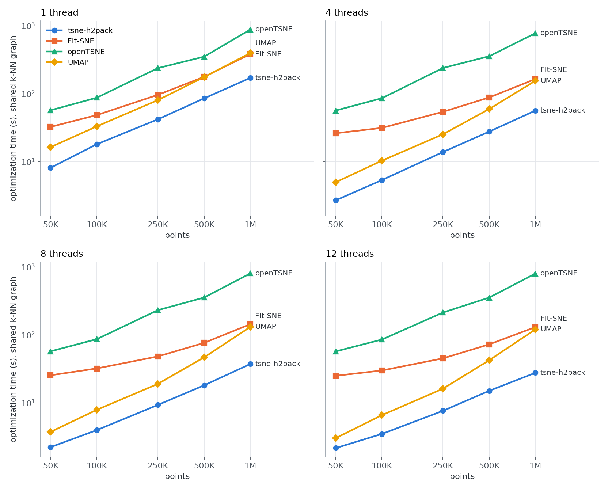

# Benchmarks

All numbers come from the project's benchmark suite, run in November 2026 on an Apple M5 Max (12 performance cores, 6 efficiency cores, 36 GB) under macOS 27.2 with tsne-h2pack 3.2.0. Thread counts are 1, 4, 8 and 12. Times are in seconds.

## Setup

- **Data.** The 10x Genomics mouse brain cells, 50 PCA components, subsampled to 50K–1M points.
- **Pipeline.** PyNNDescent k-NN graph with k = 90, perplexity 30, random initialization, 1000 iterations of which the first 250 use early exaggeration 12, and `learning_rate="auto"`.
- **Defaults only.** One configuration for every size, with no per-size tuning.
- **Quality.** KL divergence against a common P, and the fraction of each point's 10 nearest neighbors preserved in the embedding.

## 2D: scaling with data size and threads

| Points | Optimization, 1 thread (s) | 4 threads (s) | 8 threads (s) | 12 threads (s) | Speedup, 1 → 12 threads | End to end, 12 threads (s) | Peak memory (GB) |
|---|---|---|---|---|---|---|---|
| 50K | 8.2 | 2.7 | 2.2 | 2.2 | 3.8× | 4.1 | 1.4 |
| 100K | 18.2 | 5.4 | 4.0 | 3.5 | 5.2× | 7.5 | 2.2 |
| 250K | 42.2 | 14.0 | 9.4 | 7.7 | 5.5× | 18.1 | 4.2 |
| 500K | 85.8 | 27.9 | 18.2 | 15.1 | 5.7× | 36.3 | 9.1 |
| 1M | 171.8 | 56.8 | 37.5 | 27.8 | 6.2× | 69.3 | 15.7 |

Times are means of 3 runs (2 runs at 500K, 1 run at 1M). Optimization time grows roughly linearly with N: doubling the data roughly doubles the time. Four threads give a 3.0–3.4× speedup at every size. Beyond that, parallel efficiency improves with size, because larger problems give each thread more work per synchronization; at 50K points the eight-to-twelve-thread step gains nothing.

"End to end" includes the k-NN search and the P matrix. At 1M points on 12 threads it splits into 35 s for the k-NN graph, 7 s for P and setup, and 28 s for the optimization. Once the optimizer is this fast, the neighbor search is the largest cost.

### Inside the optimization

Share of the 2D optimization time on 12 threads:

| Points | Attractive forces | H² rebuild | H² product | Other |
|---|---|---|---|---|
| 50K | 20% | 37% | 31% | 13% |
| 250K | 22% | 39% | 30% | 8% |
| 1M | 28% | 38% | 30% | 3% |

The H² matrix is rebuilt every third iteration and multiplied once per rebuild. Together these take about two thirds of the time. See [How it works](technical/algorithm.md) for what each part does.

## 3D: scaling with data size and threads

tsne-h2pack runs unchanged with `n_components=3`, using the 3D default `h2_tol=3e-2`. Each 3D size was run once.

| Points | Optimization, 1 thread (s) | 4 threads (s) | 8 threads (s) | 12 threads (s) | Speedup, 1 → 12 threads | End to end, 12 threads (s) | Peak memory (GB) |
|---|---|---|---|---|---|---|---|
| 50K | 54.8 | 16.4 | 9.1 | 7.4 | 7.4× | 9.3 | 1.2 |
| 100K | 178.6 | 42.1 | 22.9 | 17.6 | 10.2× | 21.7 | 2.3 |
| 250K | 288.8 | 86.4 | 49.5 | 39.3 | 7.4× | 49.8 | 5.1 |
| 500K | 930.0 | 263.7 | 146.4 | 106.6 | 8.7× | 127.4 | 9.5 |
| 1M | 1273.1 | 361.7 | 219.3 | 172.4 | 7.4× | 214.5 | 16.3 |

3D costs 3–7× as much as 2D at the same N on 12 threads. The kernel's numerical rank is higher in 3D, about 40 at the default tolerance against about 10–17 in 2D. The 3D times are less regular in N than the 2D ones: the attractive-force pass costs about twice as much per point at 100K and 500K as at the neighboring sizes, at every thread count. Thread scaling is better than in 2D because the H² rebuild, the largest part, parallelizes well.

FFT-accelerated t-SNE does not support 3D, so other libraries fall back to Barnes-Hut trees there. In the same suite, their optimization took about 5–10× longer than tsne-h2pack's on 4 threads, 8–19× longer on 8 and 9–16× longer on 12, and tsne-h2pack's embeddings had lower KL divergence and better neighbor preservation at every size.

## Comparison to other t-SNE implementations

To compare gradient methods fairly, openTSNE and FIt-SNE were given the **same k-NN graph and the same P** as tsne-h2pack, so only the optimization differs. Each library used its own default learning-rate rule.

2D optimization time in seconds, on log scales, for 1, 4, 8 and 12 threads. UMAP is shown for reference; it optimizes a different objective.

2D optimization time on 12 threads:

| Points | tsne-h2pack (s) | FIt-SNE (s) | openTSNE (s) |
|---|---|---|---|
| 50K | 2.2 | 25.1 | 57.3 |
| 250K | 7.7 | 45.3 | 213.9 |
| 1M | 27.8 | 130.8 | 800.3 |

The three t-SNE embeddings reach matching quality at every size: KL within 2.5% and neighbor preservation within 0.014 of the best of the three. openTSNE's macOS wheel is built without OpenMP, so its times do not change with the thread count on a Mac.

## Comparison to UMAP

UMAP optimizes a different objective, so its KL and neighbor-preservation scores are not directly comparable. On its own defaults and a k = 15 graph from the same k-NN code, UMAP's optimization took 3.0 s at 50K and 121 s at 1M points on 12 threads. tsne-h2pack took 2.2 s and 28 s.

## Caveats

- **Learning rate.** tsne-h2pack keeps scikit-learn's factor 4 in the gradient. Libraries that drop it take a 4× smaller step at the same nominal learning rate, so "auto" rules are not identical across libraries.
- **Self-reported KL.** Each library computes its own KL, so those numbers are not comparable. The quality numbers here are all recomputed against one common P.
- **Memory.** tsne-h2pack's peak memory is 16 GB at 1M points in both 2D and 3D, somewhat more than FFT-based implementations need.
- **Hardware.** One laptop. macOS decides which cores run the threads, and some work may have landed on the slower efficiency cores, so the times are an upper bound on what the hardware can do. Thread scaling on server cores can differ.

## Reproducing the benchmarks

The suite lives in the [`benchmarks/`](https://github.com/xinxing02/tsne-h2pack-python/tree/main/benchmarks) folder of the repository. Its README describes the protocol, and `config.py` holds the sizes, thread counts and repetitions. The full sweep takes several hours on a laptop.
