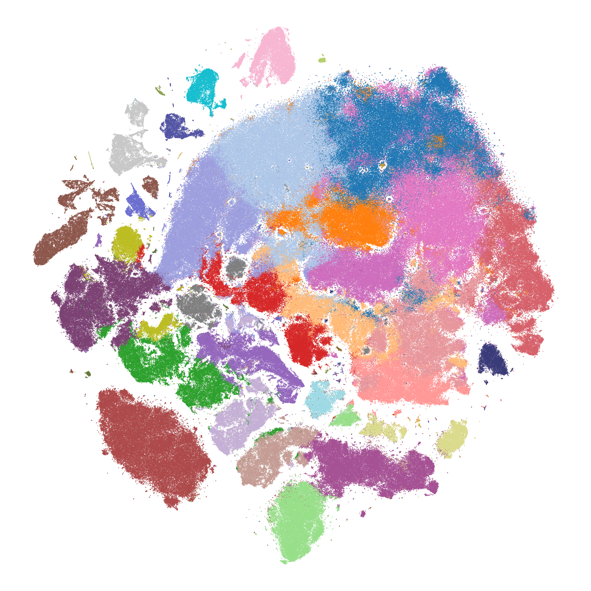
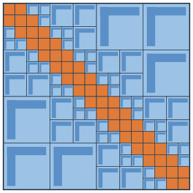

# tsne-h2pack

<div class="lead" markdown>
**t-SNE in linear time, for millions of points, in 2D or 3D.**
</div>

<div class="split" markdown>
<div class="split-text" markdown>

tsne-h2pack computes the all-pairs repulsion of t-SNE with an H² matrix, so every iteration costs O(N) instead of O(N²). It follows the scikit-learn interface, so most existing code needs only a new import; see the [differences](quickstart.md#differences-from-scikit-learn).

```bash
pip install tsne-h2pack
```

```python
from tsne_h2pack import TSNE

Y = TSNE(n_jobs=8).fit_transform(X)
```

Wheels for Linux x86-64 and Apple Silicon macOS, Python 3.9–3.14.

</div>
<div class="split-figure" markdown>



<p class="figure-caption">1,306,127 mouse brain cells, 39 cell types. 106 seconds end to end on 12 cores of an Apple M5 Max laptop.</p>

</div>
</div>

<div class="tiles">
  <div class="tile"><b>O(N)</b><span>cost per iteration, from an H² matrix of the kernel</span></div>
  <div class="tile"><b>69 s</b><span>for 1M points end to end, 12 threads, k-NN included</span></div>
  <div class="tile"><b>2D &amp; 3D</b><span>same algorithm and code path in either dimension</span></div>
  <div class="tile"><b>sklearn-style API</b><span><code>fit_transform</code> with scikit-learn's parameter names</span></div>
</div>

## The idea in one picture

<div class="split split-reverse" markdown>
<div class="split-figure narrow" markdown>



</div>
<div class="split-text" markdown>

The repulsive force needs the product of a dense N × N kernel matrix with the embedding. tsne-h2pack never forms that matrix.

- <span class="swatch near"></span> **Nearby points** interact through small dense blocks along the diagonal, computed exactly.
- <span class="swatch far"></span> **Distant groups** interact through low-rank blocks, whose bases are nested across the levels of a spatial tree.

The nesting makes both building and applying the matrix linear in N, at a chosen accuracy. One product then gives the full repulsive force and its normalization. [Read how it works &rarr;](technical/algorithm.md)

</div>
</div>

## Time grows roughly linearly with N

Optimization time on 12 threads (Apple M5 Max), 1000 iterations, mouse brain cells in 50 PCA dimensions:

| Embedding | 50K points | 100K | 250K | 500K | 1M |
|---|---|---|---|---|---|
| 2D | 2.2 s | 3.5 s | 7.7 s | 15.1 s | 27.8 s |
| 3D | 7.4 s | 17.6 s | 39.3 s | 106.6 s | 172.4 s |

In 2D, doubling the data roughly doubles the time. Going from 1 to 12 threads speeds the optimization up 3.8–6.2× in 2D and 7.4–10.2× in 3D, depending on size. The advantage shows from about 50K points; below about 10K, any t-SNE library is fast. [Full benchmarks &rarr;](benchmarks.md)

## Explore the documentation

<div class="cards">
  <a class="card" href="quickstart/"><b>Quick start</b><span>Install, embed your first dataset, and plot it.</span></a>
  <a class="card" href="user-guide/"><b>How to use tsne-h2pack</b><span>Large data, k-NN methods, precomputed graphs, 3D, and parameters.</span></a>
  <a class="card" href="technical/algorithm/"><b>How it works</b><span>The gradient, the one-kernel trick, H² matrices, and force reuse.</span></a>
  <a class="card" href="technical/accuracy/"><b>Accuracy and reproducibility</b><span>Why a loose tolerance is enough, and how quality is measured.</span></a>
  <a class="card" href="benchmarks/"><b>Benchmarks</b><span>Scaling from 50K to 1M points, quality, and comparisons.</span></a>
  <a class="card" href="api/"><b>API reference</b><span>Every parameter of <code>tsne_h2pack.TSNE</code>.</span></a>
</div>

<p class="cite-note">Using tsne-h2pack in research? See <a href="citing/">how to cite it</a>.</p>
